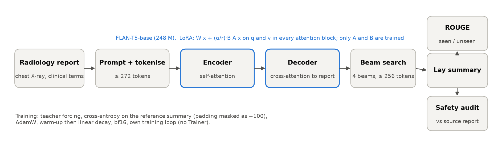
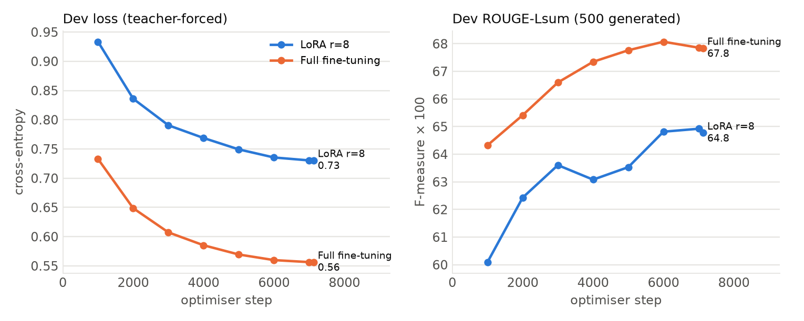
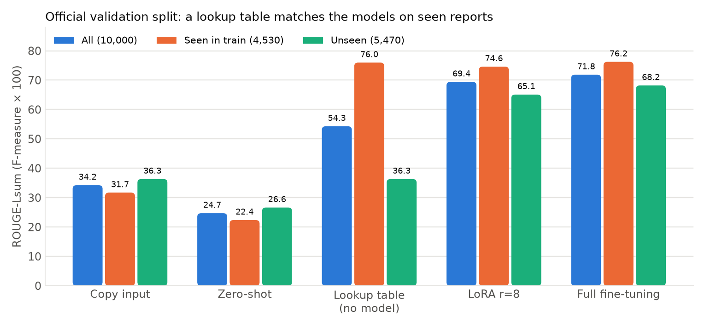
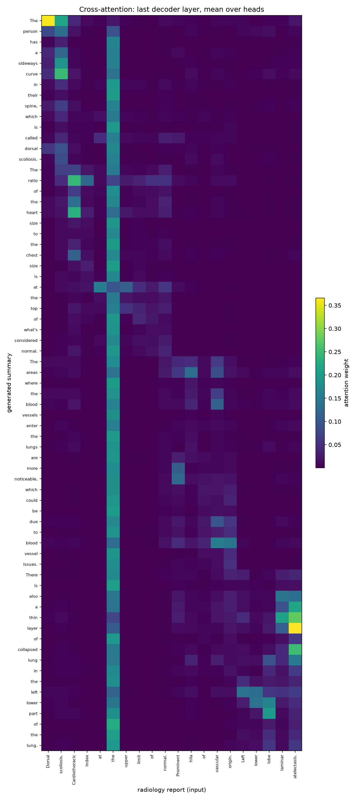

# Layperson Summarisation of Radiology Reports with FLAN-T5 and LoRA

COMP3710 Pattern Recognition Report, Project 2.6 (BioLaySumm 2025 LaymanRRG).

Author: Weixiang Han (s4909182)

## 1. Problem

Radiology reports are written for clinicians. When patients read them in an online portal, terms such as "pleural effusion" or "atelectasis" cause confusion and anxiety. This project fine-tunes FLAN-T5-base to rewrite chest X-ray reports into plain language, using the open-source track of BioLaySumm 2025 Subtask 2.1 [Xiao 2025].

The open question set by the course is whether fine-tuning improves clinical faithfulness or only surface fluency. ROUGE [Lin 2004] measures word overlap, not correctness, so a model can score well while turning "no pneumothorax" into "pneumothorax". The project therefore reports ROUGE separately for reports seen and unseen in training, and audits every output against the original report for clinical errors.

Despite the shared-task name, this is closer to translation than compression [Zhao 2026]: in this dataset, 94.9% of reference summaries are longer than their source reports. Short clinical shorthand such as "cardiomegaly" or "laminar atelectasis" has to be unpacked into multi-word plain-language explanations ("an enlarged heart", "a thin area of collapsed lung") rather than shortened.

## 2. How it works



FLAN-T5 [Chung 2022] is an encoder–decoder Transformer [Raffel 2020]. The encoder reads the whole report with self-attention; the decoder writes the summary one token at a time and uses cross-attention to look back at the report. Each report is prefixed with the instruction "Rewrite this radiology report in plain language for a patient:", so the instruction-tuned model can attempt the task even without training, which makes the zero-shot baseline meaningful.

Training uses teacher forcing: the reference summary, shifted right by one token, is fed to the decoder, and the loss is the cross-entropy of predicting each next token. Padding positions in the labels are set to −100 so they do not count.

Three ways of adapting the model are compared:

- **Zero-shot**: no training.
- **Full fine-tuning**: all 247,577,856 parameters are updated.
- **LoRA** [Hu 2022]: the pretrained weight W is frozen and each adapted layer computes W x + (α / r) B A x, where A is r × d and B is d × r. B starts at zero, so training begins exactly at the pretrained model. With r = 8 and α = 16 on the query and value projections of every attention block (72 matrices in the encoder and decoder), only 884,736 parameters (0.36%) are trained. The layer is implemented from scratch in `modules.py`; after training, B A can be merged back into W.

The training loop and evaluation are written by hand in `train.py` and `utils.py`; the Hugging Face Trainer is not used.

Updating a full `d × d` projection matrix directly learns `d²` weights, whereas factoring the update into `B` (`d × r`) and `A` (`r × d`) with `r ≪ d` learns only `2 r d` weights (for `d = 768` and `r = 8`, 12,288 weights instead of 589,824 per matrix) and shrinks the saved checkpoint from 990 MB to 3.6 MB. In `modules.py`, `A` uses Kaiming uniform initialisation and `B` starts at zero, so `B A = 0` at step 0 (keeping the exact pretrained outputs initially) while `B` still receives non-zero gradients on the first backward pass.

## 3. Feasibility review

This section reproduces the one-page review presented at the check-off on 29 October 2026; its "next experiment" (the manual case autopsy) is completed in Section 10.

### Feasibility Review: Layperson Summarisation of Radiology Reports

Weixiang Han (s4909182) · COMP3710 Project 2.6 · Hard difficulty · 29 Oct 2026

#### 1. User need, scope and acceptance criteria

**User.** A hospital patient-portal team that wants chest X-ray reports rewritten in plain language before patients read them. **Purpose.** Decide whether a fine-tuned FLAN-T5 is safe enough to move toward patient-facing use, or whether ROUGE gains hide clinical errors.

| # | Criterion (on the held-out split) | Threshold | Evidence so far |
|---|---|---|---|
| 1 | ROUGE-Lsum on reports never seen in training | above zero-shot (26.6) and copy-the-input (36.3) | met: LoRA 65.1, full 68.2 |
| 2 | Polarity flips on 9 tracked findings ("no pneumothorax" becoming present, or the reverse) | ≤ 1 per 100 reports that state a tracked finding | met: LoRA 0.06, full 0.03 (zero-shot 4.8) |
| 3 | Median Flesch–Kincaid grade | ≤ 8 and not above the references (7.2) | met: LoRA 7.2, full 7.2 (zero-shot 12.0) |
| 4 | LoRA against full fine-tuning | within 1 ROUGE-Lsum point | not met: 2.4 lower overall, 3.1 on unseen reports |
| 5 | Resources | LoRA trains < 1% of parameters; one A100; ≤ 2 h per run | met: 0.36%, 24 GB, 64 min |

#### 2. Model choice and course concepts

**Data.** BioLaySumm 2025 LaymanRRG, open-source track, official splits. The official test split has no references, so the official validation split (10,000 pairs) is the held-out set.

**Model.** FLAN-T5-base (248 M parameters), an encoder–decoder Transformer [Raffel 2020; Chung 2022], compared as zero-shot, LoRA and full fine-tuning. LoRA [Hu 2022] is my own PyTorch layer on the attention query and value projections (rank 8, 0.88 M trainable parameters). The training loop and evaluation are written by hand, without the Hugging Face Trainer. The top open-track system at BioLaySumm 2025 was a T5-large that beat a 3 B-parameter LLaMA on nine of ten metrics [Xiao 2025], which supports an encoder–decoder at this scale.

**Course concepts.** Self-attention and cross-attention, transfer learning, sequence-to-sequence training with teacher forcing, and leakage control.

#### 3. Preliminary evidence

- **The validation split leaks.** 45.3% of validation reports also occur in train, and for 23.8% the exact (report, summary) pair is in train. A lookup table with no model scores ROUGE-Lsum 76.0 on those seen reports, so every result is reported separately for seen and unseen reports. Training on the official split raises overall ROUGE only on those leaked pairs.
- **ROUGE is unreliable here.** Copying the input scores 34.2, above zero-shot FLAN-T5 at 24.7. For one template sentence (224 reports), three clinically equivalent outputs score between 29 and 93.
- **Fine-tuning is feasible.** Eleven runs are complete, about one hour each on one A100. On the official split LoRA reaches 69.4 and full fine-tuning 71.8 ROUGE-Lsum overall. A stricter de-duplicated split gives the same unseen scores, and three seeds per method vary by at most 0.4.
- **First safety audit (post-hoc).** On the 3,515 reports that state a tracked finding as present or absent, both fine-tuned models flip a finding in fewer than 1 in 1,000 reports on the official split, against 4.8 per 100 for zero-shot. Full fine-tuning's higher ROUGE does not mean fewer errors: over three seeds it omits 5.3 of every 100 positive findings, LoRA 4.7.

#### 4. Risks, budget, next experiment and fallback

| Risk | Mitigation |
|---|---|
| ROUGE rewards memorised templates | Seen / unseen reporting; copy-the-input and lookup baselines |
| References are machine-generated; no patient IDs | Audit outputs against the source report, not the reference; stated as a limitation |
| The audit checker was refined on the same outputs it scores | Every flagged flip checked by hand; results labelled post-hoc |

**Budget.** About 11 GPU-hours used; no further training runs are needed for the core comparison.  
**Next experiment.** Manual autopsy of 3–5 cases (hallucination, critical omission, readability), and extend the checker to laterality, severity and certainty changes, which it does not yet cover.  
**Fallback.** The checker's recall on implicit negations is unmeasured; if a hand-checked random sample of 100 summaries disagrees with it, report the manual rates instead.

## 4. Files

| File | Contents |
|---|---|
| `dataset.py` | Loading the parquet files, the two split modes, the prompt, the dataset class and the dynamic-padding collator |
| `modules.py` | The LoRA layer, injecting it into T5, merging, adapter-only checkpoints and the model builder |
| `train.py` | The training loop, dev evaluation, checkpointing and held-out test scoring |
| `utils.py` | ROUGE, batched beam-search generation, bf16 autocast, checkpoint I/O and training curves |
| `predict.py` | Example usage: loads a checkpoint, prints summaries next to the reference and saves cross-attention heatmaps |
| `audit.py` | The clinical safety audit |
| `test_lora.py` | Tests for the LoRA layer |
| `slurm_train.sh` | Slurm script for one Rangpur A100 |
| `requirements.txt` | Exact package versions from the Rangpur environment |

## 5. Dependencies and reproduction

Experiments ran on the Rangpur cluster, one NVIDIA A100 40 GB per run.

| Package | Version |
|---|---|
| Python | 3.11.15 |
| torch | 2.13.0 (CUDA 13.0 build) |
| transformers | 5.18.0 |
| sentencepiece | 0.2.2 |
| tokenizers | 0.23.2 |
| pandas | 3.0.6 |
| pyarrow | 25.0.1 |
| numpy | 2.4.6 |
| rouge_score | 0.1.2 |
| nltk | 3.10.3 |
| matplotlib | 3.11.2 |
| textstat | 0.7.13 |

Download the data (two parquet files, 28 MB):

```bash
REPO=BioLaySumm/BioLaySumm2025-LaymanRRG-opensource-track
mkdir -p data
for s in train validation; do
  curl -L -o data/$s.parquet \
    https://huggingface.co/datasets/$REPO/resolve/main/data/$s-00000-of-00001.parquet
done
```

Smoke-test first on a tiny setup (offline unit check on a synthetic T5, then a small subsample on CPU or in an interactive Rangpur GPU session via `srun --partition=comp3710 --account=comp3710 --gres=gpu:1 --pty bash`) before launching full runs:

```bash
python test_lora.py
python train.py --mode lora --model google/flan-t5-small --data_dir data \
  --out_dir runs/smoke --max_train_samples 64 --max_dev_samples 32 \
  --max_test_samples 32 --epochs 1 --batch_size 8
```

Full training and held-out evaluation (each run writes predictions, metrics, curves and resource usage to `--out_dir`):

```bash
python train.py --mode zero_shot --data_dir data --out_dir runs/zero_shot
python train.py --mode lora --data_dir data --out_dir runs/lora_r8_official \
  --rank 8 --seed 0 --eval_every 1000
python train.py --mode full --data_dir data --out_dir runs/full_official \
  --seed 0 --eval_every 1000
```

On the Rangpur HPC cluster (`comp3710` partition; data and Hugging Face model weights cached once on the login node so compute nodes run offline with `HF_HUB_OFFLINE=1`), full runs are submitted through `slurm_train.sh`, for example `sbatch --job-name=lora slurm_train.sh lora runs/lora_r8_official --rank 8 --seed 0 --eval_every 1000`. Add `--split controlled` for the de-duplicated split described in Section 6.

Audit, example usage and tests:

```bash
python audit.py \
  runs/lora_r8_official/test_predictions.csv \
  runs/full_official/test_predictions.csv \
  runs/zero_shot/test_predictions.csv \
  --seen_from runs/lora_r8_official/test_predictions.csv
python predict.py --mode lora --checkpoint runs/lora_r8_official/best.pt \
  --data_dir data --compare_zero_shot
python test_lora.py
```

Seeds are fixed (`--seed`), and the controlled split is decided by an MD5 hash of the report text, so it is identical on every machine.

## 6. Data and pre-processing

| Split | Pairs | PadChest | BIMCV-COVID19 | Open-i |
|---|---|---|---|---|
| Official train | 150,454 | 116,847 | 31,364 | 2,243 |
| Official validation (used as test) | 10,000 | 7,824 | 2,042 | 134 |
| Official test (no references) | 10,537 | 7,130 | 3,221 | 186 |

The official test split has no reference summaries, so the official validation split is the held-out set throughout, as the teaching team recommended. PadChest [Bustos 2020] and BIMCV-COVID19 [Vayá 2020] reports were translated from Spanish before simplification; Open-i [Demner-Fushman 2012] reports are in English. The plain-language references were generated with GPT-4o [Zhao 2026; Xiao 2025].

**Lengths.** Inputs are short (95th percentile 107 tokens), and 94.9% of references are longer than their report. The limits of 272 input tokens (256 plus the 14-token prompt) and 256 output tokens truncate about 1.3% of pairs.

**Leakage.** The official validation split overlaps heavily with the official train split:

| | Rows | Share of validation |
|---|---|---|
| Report text also in train ("seen") | 4,530 | 45.3% |
| The exact (report, summary) pair also in train | 2,385 | 23.8% |
| Report text not in train ("unseen") | 5,470 | 54.7% |

Identical reports rarely have identical summaries: of the 12,572 reports that appear more than once in train, only 2.6% always have the same summary, and one has 329 different summaries. This caps ROUGE, because no single output can match every reference.

**Two split modes.** Headline results use the official train split as released (`--split official`). Because it has no held-out dev set, those runs train for a fixed two epochs and test the final checkpoint. A stricter `--split controlled` variant removes 138 train rows from the same imaging studies as validation, de-duplicates (report, summary) pairs (113,993 left) and separates a 2,275-pair dev split by hashing the report text, so no dev report is seen in training. It is used for seeds, ablations and checkpoint selection. A side effect is that one frequent template, "Within normal limits." (3,228 train rows), left the training set entirely (Section 8).

The official validation split is kept as the held-out evaluation set (following the teaching team's guidance) so the scores remain comparable with BioLaySumm baselines, while reporting seen and unseen subsets separately shows how much of overall ROUGE comes from memorised templates.

## 7. Training

| Setting | LoRA | Full fine-tuning | Reason |
|---|---|---|---|
| Learning rate (AdamW) | 1e-3 | 1e-4 | LoRA trains few, freshly initialised weights; full fine-tuning must not disturb the pretrained ones |
| Schedule | linear warm-up over 5%, then linear decay | same | standard |
| Batch size, epochs | 32, 2 | same | fits one A100 |
| Gradient clipping | 1.0 | same | stability |
| Precision | bfloat16 autocast | same | T5 overflows to NaN in float16 |
| Rank, α, targets | 8, 16, q and v | — | LoRA paper defaults |

The learning rates are common defaults and were not tuned. Training stops with an error if the loss becomes non-finite.



*Learning curves on the held-out dev split (controlled split, seed 0). Full fine-tuning passes LoRA's best dev ROUGE-Lsum within 2,000 steps.*

## 8. Results

### ROUGE on the official validation split

| Method | Subset | ROUGE-1 | ROUGE-2 | ROUGE-L | ROUGE-Lsum |
|---|---|---|---|---|---|
| Copy the input | all | 36.43 | 13.88 | 32.95 | 34.24 |
| Zero-shot | all | 26.83 | 10.10 | 24.00 | 24.70 |
| Lookup table (no model) | all | 56.64 | 38.15 | 52.88 | 54.30 |
| LoRA r = 8 | all | 72.37 | 54.06 | 67.39 | 69.40 |
| Full fine-tuning | all | 74.66 | 57.45 | 70.04 | 71.84 |
| Copy the input | seen | 33.46 | 10.50 | 31.19 | 31.71 |
| Zero-shot | seen | 23.87 | 8.20 | 21.98 | 22.37 |
| Lookup table (no model) | seen | 78.06 | 64.08 | 75.18 | 75.98 |
| LoRA r = 8 | seen | 76.86 | 61.88 | 73.78 | 74.61 |
| Full fine-tuning | seen | 78.44 | 64.17 | 75.48 | 76.24 |
| Copy the input | unseen | 38.90 | 16.67 | 34.41 | 36.33 |
| Zero-shot | unseen | 29.28 | 11.67 | 25.67 | 26.64 |
| LoRA r = 8 | unseen | 68.64 | 47.58 | 62.10 | 65.09 |
| Full fine-tuning | unseen | 71.53 | 51.87 | 65.53 | 68.20 |

The lookup table returns the most frequent training summary for a seen report and copies an unseen report unchanged. LoRA and full fine-tuning are single runs (seed 0); zero-shot is re-scored with the official seen flags.



### Seeds, splits and ablations

On the controlled split, three seeds per method give ROUGE-Lsum of 67.06 ± 0.26 (all) and 63.45 ± 0.43 (unseen) for LoRA, and 70.93 ± 0.05 and 68.45 ± 0.02 for full fine-tuning. Re-scored on the same 5,470 official unseen reports, the controlled-split models reach 64.84 (LoRA, mean of three seeds) and 67.90 (full), against 65.09 and 68.20 for the official-split runs. Training on the official split therefore raises overall ROUGE only on the leaked (report, summary) pairs.

| LoRA variant (controlled split, seed 0) | Trainable parameters | Training time | All | Unseen |
|---|---|---|---|---|
| r = 8, 2 epochs | 0.36% | 42 min | 67.37 | 63.90 |
| r = 8, 4 epochs | 0.36% | 83 min | 67.90 | 64.21 |
| r = 32, 2 epochs | 1.41% | 42 min | 68.62 | 65.09 |

Doubling the training closes 15% of the gap to full fine-tuning; raising the rank to 32 closes about 35% at no extra cost. These two runs were chosen after seeing test results, so they explain the gap rather than replace the main configuration.

A post-hoc finding: on the controlled split, about 2 ROUGE points of LoRA's unseen deficit came from the single template "Within normal limits." (224 validation rows), which was missing from that training set. Full fine-tuning answered "Everything looks normal." (ROUGE-Lsum 93.0); LoRA answered "The x-ray looks normal." (45.1, seeds 0 and 1) or "The results are normal." (28.8, seed 2, four epochs and rank 32). The three outputs are clinically equivalent. On the official split, where the sentence is in the training data, both LoRA and full fine-tuning answer "Everything looks normal."

### Resources

| | Zero-shot | LoRA r = 8 | Full fine-tuning |
|---|---|---|---|
| Total parameters | 247,577,856 | 248,462,592 | 247,577,856 |
| Trainable parameters | 0 | 884,736 (0.36%) | 247,577,856 (100%) |
| Checkpoint size | — | 3.6 MB | 990 MB |
| Training time (official split, 9,402 steps) | — | 50 min | 53 min |
| Peak training VRAM (batch 32) | — | 23,975 MiB | 29,272 MiB |
| Peak inference VRAM (batch 64, beam 4) | 6,563 MiB | 6,576 MiB | 7,039 MiB |
| Inference time per report (batch 64) | 0.113 s | 0.067 s | 0.058 s |
| Inference throughput (generated tokens/s) | 2,143 | 1,941 | 2,283 |

LoRA saves storage, not compute: it still runs the forward and backward pass through the whole network. Its inference is slower than full fine-tuning only because the adapters were not merged into the weights before testing. Zero-shot generates tokens quickly but is the slowest per report, because 4.1% of its outputs repeat themselves until the 256-token limit. A whole run, including testing on 10,000 reports, takes about 64 minutes.

### By source

| Source (official split) | Reports | LoRA r = 8 | Full fine-tuning |
|---|---|---|---|
| PadChest | 7,824 | 71.03 | 73.16 |
| BIMCV-COVID19 | 2,042 | 63.00 | 66.59 |
| Open-i | 134 | 71.72 | 75.01 |

ROUGE-Lsum. Open-i, the only source written in English originally, scores highest despite having the fewest training examples, but it has only 134 test reports. BIMCV-COVID19, with the longest reports, scores lowest.

### Comparison with the shared task

The best open-track system at BioLaySumm 2025 reported a single ROUGE score of 0.671 on the blind test set [Xiao 2025]. The aggregation is not specified, and this project evaluates on the validation split, so the numbers are not directly comparable; full fine-tuning's unseen ROUGE-1 of 71.5 and ROUGE-Lsum of 68.2 are in the same range.

## 9. Clinical safety audit

`audit.py` decides, for nine findings (pneumothorax, effusion, consolidation, atelectasis, cardiomegaly, pneumonia, nodule, fracture, mass), whether each is stated as present, uncertain, negated or not mentioned, first in the source report and then in the summary. It counts polarity flips (present in one, negated in the other), omissions (present in the report, not mentioned in the summary) and unsupported findings, and computes the median Flesch–Kincaid grade [Kincaid 1975]. Plain-language phrases for each finding were mined from sentence-aligned training pairs, and negation follows NegEx [Chapman 2001]. Summaries are compared with the source report, never with the reference.

**This analysis is post-hoc.** The checker's rules were refined over four rounds while looking at flagged validation outputs, so the rates below are not an independent estimate. The models themselves were not tuned on the validation split.

| Official split | Flips per 100 reports | Omissions per 100 positive findings | Unsupported per 100 summaries | Median FK grade |
|---|---|---|---|---|
| Source report | — | — | — | 12.1 |
| Reference | 0.23 | 7.10 | 2.85 | 7.2 |
| Zero-shot | 4.84 | 30.18 | 0.12 | 12.0 |
| LoRA r = 8 | 0.06 | 4.40 | 1.80 | 7.2 |
| Full fine-tuning | 0.03 | 5.19 | 2.15 | 7.2 |

Flips are counted over the 3,515 reports that state a tracked finding as present or absent; omissions over their 2,929 positive findings; the grade over the 6,762 reports with at least ten words. Over three seeds on the controlled split, omissions are 4.72 ± 0.18 for LoRA and 5.27 ± 0.31 for full fine-tuning.

**Checker quality.** Every flagged flip was checked by hand: for LoRA 1 of 2 was a real error, for full fine-tuning 1 of 1, and for the references 2 of 8; a random 10 of zero-shot's flips were all real. On a probe sample of simple negated clauses with the negation stripped, the checker caught about 98%. Implicit negation (for example "heart size is normal" for cardiomegaly) is not covered, and laterality, severity and certainty changes are not checked.

**What the audit shows.** Fine-tuning removes almost all of zero-shot's polarity flips and brings readability to the references' level. Full fine-tuning's higher ROUGE does not translate into fewer errors: it omits slightly more positive findings than LoRA.

## 10. Failure case autopsy

Five cases from the official validation split illustrate errors that ROUGE misses or misjudges (reviewed against the source report by a computing student without clinical training):

**Case #8987 (polarity flip with high ROUGE).** PadChest, unseen.
- Report: "Cardiomegaly is not evident. No signs of acute pulmonary edema."
- Reference: "The heart does not appear enlarged. There are no signs of sudden fluid buildup in the lungs."
- LoRA and full fine-tuning: "The heart appears enlarged, but there are no signs of sudden fluid buildup in the lungs." (ROUGE-Lsum 90.9)
- Analysis:
  - *Error category*: Hallucination / semantic contradiction.
  - *What went wrong*: The model changed "cardiomegaly is not evident" (reference: "the heart does not appear enlarged") to "the heart appears enlarged". This reverses the meaning and creates a false positive for cardiomegaly. The pulmonary oedema finding is still correct, but the wrong heart finding makes the whole output clinically inaccurate.
  - *Likely trigger*: The model probably lost the negation in "cardiomegaly is not evident" when it paraphrased. Fluent text and similar words do not mean the clinical meaning is kept.
  - *Did ROUGE notice?* No. ROUGE-Lsum is 90.9, which is high. Most of the sentence, especially the pulmonary oedema part, is still similar to the reference. ROUGE does not punish a polarity change when the other words stay the same.
  - *Deployment safeguard*: Add a negation and polarity check between the source report and the output. If a finding changes from "present" to "absent", or the reverse, send the report for review.

**Case #9656 (critical omission of a pneumothorax).** Open-i, unseen.
- Report: "Redemonstration of moderate left pneumothorax which is unchanged from comparison. Left pleural catheter is again seen overlying the left upper lung at the level of the left 5th and 6th ribs. No focal consolidation. Cardiomediastinal silhouette is normal. No change in moderate left pneumothorax with left pleural drainage catheter again seen overlying the left upper lung."
- Reference: "The repeat examination shows a moderate amount of air leakage in the left lung, which is the same as before. The left lung drainage tube is seen over the upper left lung area, near the 5th and 6th ribs. There is no localized lung thickening. The heart and middle chest area look normal. There is no change in the moderate left air leakage, and the left lung drainage tube is again seen over the upper left lung."
- LoRA: "The left side of the chest has a hazy appearance, which is the same as what was seen before. The left side of the chest has a catheter that goes into the left upper lung at the level of the left 5th and 6th ribs. There are no signs of pneumonia. The heart and middle chest area look normal. There is no change in the moderate left lung with the left side of the chest having a catheter that goes into the left upper lung." (ROUGE-Lsum 58.0, pneumothorax omitted)
- Full fine-tuning: "The left side of the chest shows a moderate amount of air leakage, which hasn't changed since the last check. A tube is seen in the left upper lung area, near the left 5th and 6th ribs. There's no sign of a specific area of lung thickening. The heart and middle chest area look normal. There's no change in the moderate air leakage on the left side, with a tube draining fluid from the left upper lung." (ROUGE-Lsum 70.1)
- Analysis:
  - *Error category*: Critical omission / semantic distortion.
  - *What went wrong*: The LoRA output changed "moderate left pneumothorax" into a vague "hazy appearance" (and garbled the final clause into "moderate left lung"). This removes an important diagnosis. The full fine-tuning output is better: "a moderate amount of air leakage" still shows the idea of pneumothorax, although "air leakage" is less precise than the original term (and it misdescribes the tube as "draining fluid").
  - *Likely trigger*: The model probably made the description too general. It may prefer simple, common words, so a rare but important medical term was lost.
  - *Did ROUGE notice?* Only partly. LoRA gets 58.0 and full fine-tuning gets 70.1, so the better output does score higher. But neither score checks if pneumothorax is kept. ROUGE alone cannot prove clinical correctness.
  - *Deployment safeguard*: Add a critical-finding check. Important diagnoses like pneumothorax must stay in the output, either as the original term or an accurate paraphrase. If one is missing, regenerate the report or send it to a clinician.

**Case #4421 (readability changes the meaning).** BIMCV-COVID19, unseen.
- Report: "A small basal right pneumothorax persists."
- Reference: "A small amount of air has leaked into the right lung, causing a minor collapse."
- LoRA: "A small area of air is still present in the lower right part of the lung." (ROUGE-Lsum 45.2) Full fine-tuning: "A small amount of air is still present in the lower part of the right lung." (ROUGE-Lsum 51.6) Both flagged as omitting the pneumothorax.
- Analysis:
  - *Error category*: Readability distortion / semantic distortion.
  - *What went wrong*: Both models changed "a small basal right pneumothorax persists" into "air is still present in the lower [right] part of the lung". This is misleading. In pneumothorax, the air is in the pleural space, outside the lung; air inside the lung is normal ventilation. The outputs are easier to read, but they lose the key anatomical detail (while the reference noted "causing a minor collapse", it similarly placed the air "into the right lung").
  - *Likely trigger*: The reference itself writes "air has leaked into the right lung", showing that this anatomical distortion was learned directly from the machine-generated training targets rather than invented during inference. When automated simplification conflates the pleural space with lung parenchyma, clinical inaccuracies are introduced upstream.
  - *Did ROUGE notice?* No, not the real error. The scores are low (45.2 for LoRA, 51.6 for full fine-tuning), so word overlap is limited, but the scores do not show the anatomical mistake, and the higher score for full fine-tuning does not mean it is correct. Both outputs were flagged for omitting pneumothorax. Readability and meaning must be checked separately.
  - *Deployment safeguard*: Use terminology-aware paraphrasing that keeps anatomy and confirmed diagnoses. A medical term checker should separate air in the lung from air in the pleural space, and flag any description that loses this difference.

**Case #6258 (faithful output, low ROUGE).** BIMCV-COVID19, seen.
- Report: "The mediastinum is of normal size. The lung parenchyma shows no abnormalities. No pleural effusion is observed."
- Reference: "Clinical judgment: The patient was admitted to the hospital with difficulty breathing. Examination: A portable chest X-ray was taken. Compared with previous studies. Findings: There is a solid area of lung tissue in the lower left part of the lung. The left side where the lung meets the diaphragm is less distinct. There might be a hiatal hernia. Original report number, date, signed, number, name, name, name, name. Clinical judgment: The patient was admitted to the hospital with difficulty breathing. Examination: A portable chest X-ray was taken. Compared with previous studies. Findings: There is a solid area of lung tissue in the lower left part of the lung. The left side where the lung meets the diaphragm is less distinct. There might be a hiatal hernia. Attachment: number, date, signed, number, name, name, name, name. Large hiatal hernia. Possible left pleural effusion."
- LoRA and full fine-tuning: "The area in the middle of the chest, called the mediastinum, is normal in size. The lungs look fine with no issues. There is no fluid buildup around the lungs." (ROUGE-Lsum 19.5)
- Analysis:
  - *Error category*: Evaluation failure / reference mismatch.
  - *What went wrong*: Both models paraphrased the source correctly. They kept the normal mediastinal size, no lung parenchymal abnormality, and no pleural effusion. But the reference describes a different examination and has findings that are not in the source. So the low score comes from a source–reference mismatch, not a model error.
  - *Likely trigger*: The source and reference may have been paired wrongly when the dataset was built, or the reference may come from another examination. This is a likely explanation, though without upstream build logs it cannot be confirmed directly.
  - *Did ROUGE notice?* ROUGE-Lsum gives 19.5, which is misleading here. It only shows low word overlap with the reference. It does not check if the output is faithful to the source.
  - *Deployment safeguard*: Check source–reference matching when building the dataset, and manually review cases with very low scores. Also add a source-based consistency check, so a correct paraphrase is not punished because of a wrong reference.

**Case #3756 (hedged finding stated as certain).** PadChest, unseen.
- Report: "The study is suboptimal due to incomplete inclusion of the pulmonary apices. Rotation to the right is noted. Persistent bilateral perihilar interstitial-alveolar infiltrates are observed. The distal end of the SNG is not clearly visualized. Blunting of the left hemidiaphragm is likely related to an associated pleural effusion."
- Reference: "The imaging is not perfect because the top parts of the lungs are not fully shown. The patient seems to have turned to the right. There are ongoing signs of fluid and inflammation around the main airways on both sides. The end of the feeding tube is not clearly seen. The left side of the diaphragm appears flattened, which could be due to fluid around the lungs."
- LoRA: "The x-ray isn't perfect because the top parts of the lungs aren't visible. The right side of the lungs is turned to the right. There are still signs of fluid in the lung tissue around the main airways on both sides. The end of the SNG isn't clearly seen. The left side of the diaphragm, which is the muscle that separates the chest from the abdomen, is less sharp than usual due to fluid around the lungs." (ROUGE-Lsum 63.5)
- Full fine-tuning: "The image quality isn't great because the top parts of the lungs aren't fully seen. The right side of the lungs is a bit tilted. There are ongoing signs of fluid in the lung tissues around the main airways on both sides. The end of the tube that helps with breathing isn't clearly seen. The left side of the diaphragm, which is the muscle that separates the chest from the abdomen, is less sharp, probably because of fluid around the lungs." (ROUGE-Lsum 59.6)
- Analysis:
  - *Error category*: Certainty change / loss of hedging.
  - *What went wrong*: The source report hedges the cause of the blunted diaphragm ("likely related to an associated pleural effusion"). LoRA drops the hedge and states it as definite ("due to fluid around the lungs"), whereas full fine-tuning keeps the uncertainty ("probably because of fluid around the lungs") and the reference says "could be due to". LoRA also leaves the Spanish abbreviation "SNG" (nasogastric feeding tube) unexplained, while full fine-tuning mislabels it as a breathing tube.
  - *Likely trigger*: During simplification, the model favours shorter, direct phrasing ("due to") and drops tentative words such as "likely".
  - *Did ROUGE notice?* No. LoRA scores higher than full fine-tuning (63.5 vs 59.6) even though LoRA turns an uncertain finding into a definite one. Removing one hedging word barely affects word overlap.
  - *Deployment safeguard*: Extend `audit.py` to check hedging markers ("likely", "possible", "suspected", "cannot exclude") so a tentative finding in the source report cannot be rewritten as a confirmed one without review.

## 11. Recommendation for the project manager

1. **Not for unsupervised patient-facing use yet.** Fine-tuning cuts polarity flips down to 0.06 (LoRA) and 0.03 (full) per 100 reports that state a tracked finding (`n = 3,515`, vs 4.84 for zero-shot), but positive-finding omissions remain 4.40 for LoRA (129 / 2,929) and 5.19 for full fine-tuning (152 / 2,929) per 100 positive findings. Even against a 5.0 per 100 positive-findings bar, full fine-tuning already exceeds it and LoRA sits close to the margin, so neither model is safe to show to patients standalone.
2. **Clinical guardrail.** Because the radiologist's report always exists (unlike image-to-text generation), show the plain-language summary side-by-side with the original report, run `audit.py` (extended to cover certainty/hedging and laterality) on every output, and route any flagged flip, omission or certainty change to clinician review.
3. **Model choice (and answer to the Section 2.6 question).** Fine-tuning improves clinical faithfulness vastly over zero-shot, but between fine-tuned models higher ROUGE does not mean safer outputs: full fine-tuning gains 3.1 ROUGE-Lsum points on unseen reports (68.20 vs 65.09) yet omits slightly more positive findings than LoRA both on the official split (5.19 vs 4.40 per 100 positive findings) and across three controlled-split seeds (5.27 ± 0.31 vs 4.72 ± 0.18). Given similar training time (~50 min) and no safety advantage from updating all weights, LoRA's 3.6 MB adapter is preferred when one base model serves multiple hospital tasks, while full fine-tuning (990 MB) only buys slightly higher ROUGE on unseen reports (68.20 vs 65.09) with no measurable gain in clinical safety.
4. **Staged rollout.** Shadow mode (clinicians read summaries, patients do not) → guarded pilot with the original report shown side-by-side and automated flagging → wider portal release only after clinician sign-off on pilot audits.
5. **Monitoring and retraining (drift triggers).** During the guarded pilot, audit a rolling window of at least 200 positive findings to avoid small-sample noise: pause and retrain if omissions drift above 6.5 per 100 positive findings (degrading from the 4.4–5.2 validation baseline toward the noisy GPT-4o reference rate of 7.10), if flagged flips exceed the 1.0 per 100 tracked-reports threshold, or immediately if any single polarity flip is confirmed on an acute finding such as pneumothorax or pulmonary oedema.
6. **Contestability.** Every summary should display the original report alongside it, state that it is an automated plain-language aid rather than the clinical record, and provide a direct way to message the care team.

## 12. Limitations

- References were generated by GPT-4o; the dataset authors checked only 500 sentence pairs by hand, on MIMIC-CXR rather than these datasets [Zhao 2026]. Two of eight flagged reference flips were real errors, and at least two references describe a different report.
- PadChest and BIMCV reports were machine-translated from Spanish; only chest X-rays are covered.
- There are no patient IDs, so patient-level separation between train and validation cannot be verified.
- The safety audit is post-hoc, rule-based, covers nine findings only and was carried out by a student without clinical training; no radiologist reviewed it.
- Official-split runs use one seed; learning rates were not tuned.

## 13. Example usage

```bash
python predict.py --mode lora --checkpoint runs/lora_r8_official/best.pt \
  --data_dir data --compare_zero_shot
```

prints each sampled report next to its reference and the summaries, with ROUGE-Lsum, and saves a cross-attention heatmap per example in `predict_outputs/`. Example (report #3766, unseen in training):

- **Report:** Dorsal scoliosis. Cardiothoracic index at the upper limit of normal. Prominent hila of vascular origin. Left lower lobe laminar atelectasis.
- **Zero-shot:** "The left lower lobe has laminar atelectasis. The left lower lobe has laminar atelectasis. …" (ROUGE-Lsum 12.2)
- **LoRA:** "The person has a sideways curve in their spine, which is called dorsal scoliosis. The ratio of the heart size to the chest size is at the top of what's considered normal. The areas where the blood vessels enter the lungs are more noticeable, which could be due to blood vessel issues. There is also a thin layer of collapsed lung in the left lower part of the lung." (75.0)
- **Reference:** "The person has a sideways curve in their spine called dorsal scoliosis. The size of the heart compared to the chest cavity is at the upper limit of what is considered normal. The areas where blood vessels enter the lungs are more noticeable than usual. There is a thin area of collapsed lung in the left lower lobe."

<p align="center"></p>

*Cross-attention of the LoRA model for report #3766 (last decoder layer, mean over heads): each row is a word of the generated summary, each column a word of the report.*

In the heatmap, the plain-language words "sideways curve" attend sharply to "scoliosis." in the report, and "thin layer of collapsed lung" aligns with "laminar" and "atelectasis.", while the vertical band on "the" reflects attention placed on a common function word when no content word is needed.

## 14. Tests

Following the incremental generative-model testing workflow, `test_lora.py` runs eight offline unit checks on a tiny synthetic T5 (`d_model = 32`, two encoder and two decoder layers) before touching the 248 M checkpoint or the radiology data: the adapted model starts identical to the pretrained one (`B A = 0`), outputs match `W x + (α / r) B A x` with rank `≤ r`, only `lora_A` and `lora_B` are trainable and receive gradients, 20 AdamW steps reduce loss on a toy sequence batch, merging and unmerging leave outputs unchanged, and an adapter-only checkpoint reloads cleanly:

```bash
python test_lora.py
# optional: verify the 884,736 / 248,462,592 parameter count on FLAN-T5-base
python test_lora.py --pretrained google/flan-t5-base
```

## 15. Artificial Intelligence Usage Disclosure

- **Tools.** Claude (Claude Code, desktop app) and Google Gemini (web, Antigravity IDE, Google Colab).
- **What Claude did.** Compiled the reading list and project plan; wrote and ran the data-audit, leakage and post-hoc fidelity scripts outside the repository; drafted the repository code (`dataset.py`, `modules.py`, `train.py`, `utils.py`, `predict.py`, `audit.py`, `test_lora.py`, `slurm_train.sh`), the feasibility review and the initial draft of this README; generated the four figures; submitted the 11 Rangpur jobs with my approval; and created earlier commits on my instruction (six commits on 5 October were created in the same minute).
- **What Gemini did.** Answered questions about the papers (checked against the original PDFs, where errors such as swapped table columns were corrected); ran pre-submission reviews and post-hoc supplementary runs on Google Colab (recorded in the project log outside this report); checked the five Section 10 autopsy cases against `test_predictions.csv`; and drafted `requirements.txt` and candidate text for the remaining README placeholders (premature local commits created during drafting were reset before pushing).
- **AI-drafted passages.** Parts of Sections 1, 2, 5, 6, 10 (the analysis of Case #3756), 11, 13, 14 and 15 are based on text drafted by Claude and Gemini; I reviewed it and adopted it as my own.
- **How I verified.** I checked the relevant source code and compared the experimental results with `config.json` and `test_metrics.json`. I also checked the relevant paper details against the original PDFs and compared the cases reported by `audit.py` with the records in `test_predictions.csv` to verify the case analyses and correct errors in the quoted report/output text. Before committing changes, I checked `git status` and `git diff` to ensure that only the intended files were included.
- **Empirical testing of AI-suggested code.** Beyond code reading, the implementation was empirically tested incrementally: running the eight offline unit tests in `test_lora.py` on a synthetic T5, stepping through a single batch and small-scale subsample smoke runs (`--max_train_samples`, `flan-t5-small`) before submitting full Slurm jobs on Rangpur, reproducing and fixing two silent checkpoint-loading bugs (`5e1f4c0` in `utils.py`, `bb7787c` in `predict.py`), and testing `audit.py` on the reference summaries themselves and on a negation-stripped probe sample before reporting clinical error rates.
- **Originality, external sources and responsibility.** No code was copied from fellow students or reused from previous years' pull requests (previous pull requests were consulted only for expected repository layout and report structure). Algorithmic ideas adapted from the literature are cited in the code docstrings and Section 16: low-rank adaptation follows Hu et al. [Hu 2022] (`modules.py`), clause-level negation cues follow NegEx [Chapman 2001] (`audit.py`), readability uses the Flesch–Kincaid grade [Kincaid 1975] (`audit.py`), and the pretrained backbone uses Hugging Face `transformers` (`T5ForConditionalGeneration` [Raffel 2020; Chung 2022]). I accept full personal responsibility for every line of code, loss calculation and metric in this submission.

## 16. References

- Bustos, A. et al. (2020). PadChest: A large chest x-ray image dataset with multi-label annotated reports. *Medical Image Analysis*, 66, 101797.
- Chapman, W. W. et al. (2001). A simple algorithm for identifying negated findings and diseases in discharge summaries. *Journal of Biomedical Informatics*, 34(5), 301–310.
- Chung, H. W. et al. (2022). Scaling instruction-finetuned language models. arXiv:2210.11416.
- Demner-Fushman, D. et al. (2012). Design and development of a multimodal biomedical information retrieval system. *Journal of Computing Science and Engineering*, 6(2), 168–177.
- Hu, E. J. et al. (2022). LoRA: Low-rank adaptation of large language models. *ICLR 2022*.
- Kincaid, J. P. et al. (1975). Derivation of new readability formulas for Navy enlisted personnel. Naval Technical Training Command.
- Lin, C.-Y. (2004). ROUGE: A package for automatic evaluation of summaries. *Text Summarization Branches Out*.
- Raffel, C. et al. (2020). Exploring the limits of transfer learning with a unified text-to-text transformer. *JMLR*, 21(140), 1–67.
- de la Iglesia Vayá, M. et al. (2020). BIMCV COVID-19+: A large annotated dataset of RX and CT images from COVID-19 patients. arXiv:2006.01174.
- Xiao, C. et al. (2025). Overview of the BioLaySumm 2025 shared task on lay summarization of biomedical research articles and radiology reports. *BioNLP 2025*, 365–377.
- Zhao, K. et al. (2026). X-ray made simple: Lay radiology report generation and robust evaluation. *Findings of ACL 2026*. arXiv:2406.17911.
